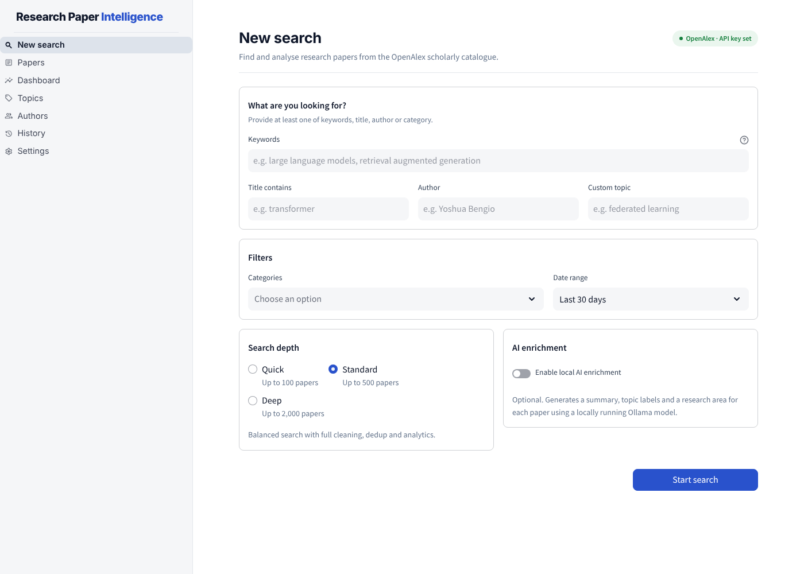
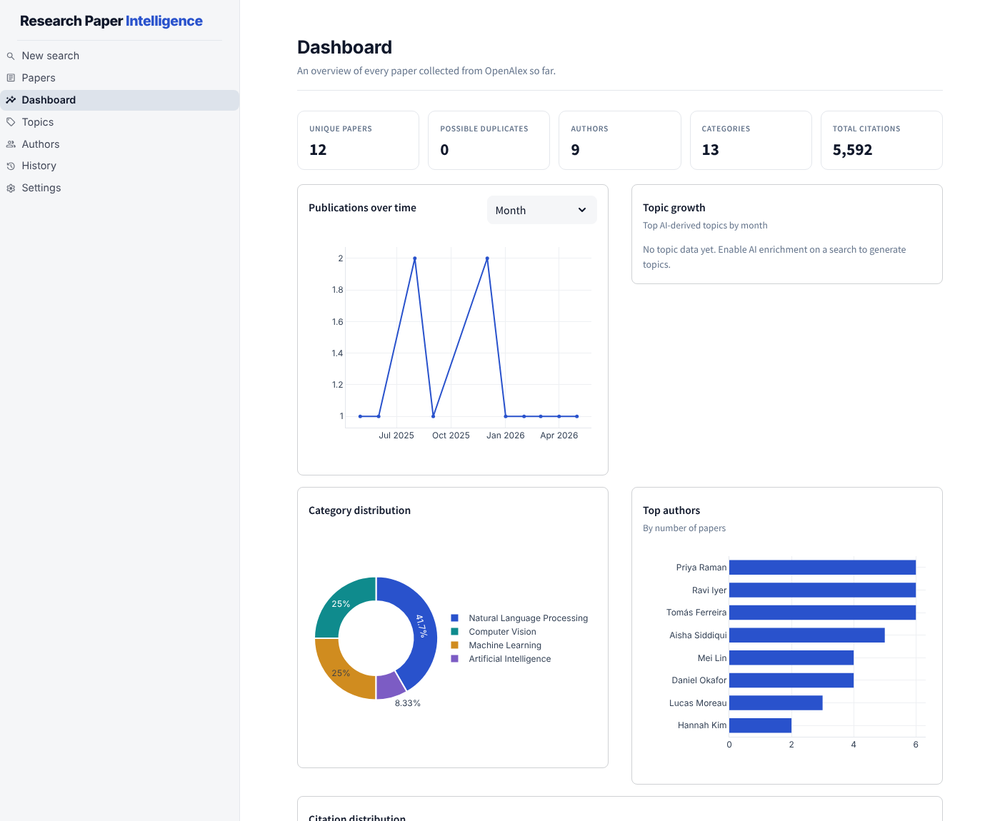
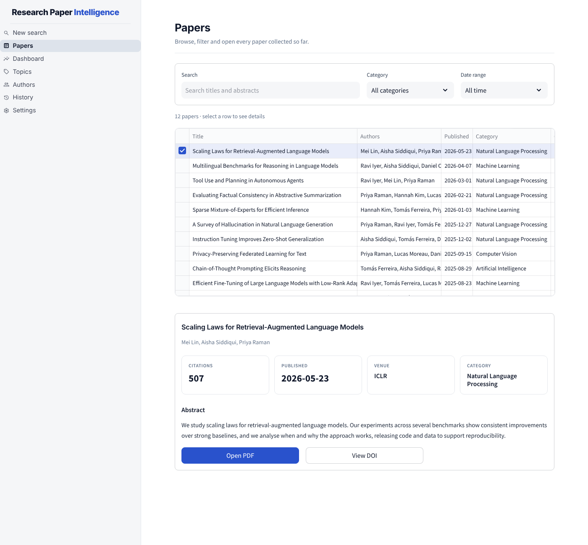

# Research Paper Intelligence & Analytics Pipeline

A free, local, privacy-friendly tool for searching and analysing research
papers. Search the [OpenAlex](https://openalex.org) scholarly catalogue from
a clean web dashboard, store deduplicated papers in PostgreSQL, explore
dbt-powered analytics, and optionally enrich papers with a locally running
LLM (via Ollama). You don't need to write code, edit config files, or send
your data to any AI service.

Built as a B.Tech final-year project to demonstrate data engineering,
analytics, orchestration and LLM engineering skills, while staying usable
on a modest 8GB RAM laptop.



---

## Table of contents

**For users**
1. [Features](#features)
2. [Screenshots](#screenshots)
3. [Requirements](#requirements)
4. [Quick start (Docker)](#quick-start-docker)
5. [Get your free OpenAlex API key](#get-your-free-openalex-api-key)
6. [Everyday commands](#everyday-commands)
7. [Using the app](#using-the-app)
8. [Local LLM setup (optional)](#local-llm-setup-optional)
9. [Troubleshooting](#troubleshooting)

**For developers**

10. [Architecture](#architecture)
11. [Project structure](#project-structure)
12. [Database architecture](#database-architecture)
13. [dbt architecture](#dbt-architecture)
14. [Airflow setup](#airflow-setup)
15. [Configuration files](#configuration-files)
16. [Testing](#testing)
17. [Running without Docker](#running-without-docker)
18. [Project limitations](#project-limitations)
19. [Future improvements](#future-improvements)
20. [License](#license)

---

## Features

- 🔎 **No-code search**: keywords, title filter, author, categories, date
  range, and a Quick / Standard / Deep search depth.
- 📚 **Powered by OpenAlex**: a free, open catalogue of scholarly works.
  OpenAlex is the single paper source, so results are consistent and you
  only need one free API key.
- 🧹 **Cleaning, normalization and 4-tier deduplication** (DOI → OpenAlex
  ID → exact title → fuzzy title). Fuzzy matches are flagged for review,
  never silently merged.
- 🗄️ **PostgreSQL storage** with a fully normalized schema. The raw OpenAlex
  record is preserved for every paper.
- 🔧 **dbt transformations** producing staging → intermediate → mart models:
  publication trends, topic growth, author, category and citation statistics.
- 🤖 **Optional local AI enrichment** via [Ollama](https://ollama.com):
  summaries, topics and research area, with strict JSON validation and
  automatic retries. The app works fully without it.
- 📊 **Clean, professional UI** with Dashboard, Papers, Topics, Authors,
  History and Settings pages.
- 📤 **CSV / JSON / PDF export**.
- ⏱️ **Scheduled recurring searches** via Apache Airflow (optional).
- 🐳 **One-command Docker install.**
- 🔒 **Local-first**: no cloud database, no hosted backend, no paid APIs.

---

## Screenshots

> The screenshots use sample data.

| Dashboard | Papers |
|---|---|
|  |  |

---

## Requirements

- [Docker Desktop](https://www.docker.com/products/docker-desktop/), which
  includes Docker Compose. **This is the only hard requirement.**
- A free [OpenAlex API key](#get-your-free-openalex-api-key) (strongly
  recommended).
- About 4GB of free RAM for the default setup (Postgres + app). 8GB of total
  system RAM is enough.
- (Optional) [Ollama](https://ollama.com) installed on your computer if you
  want AI enrichment.

> **RAM budget note (8GB machines):** Postgres and the Streamlit app
> together use roughly 1–1.5GB. Airflow (optional) adds about 1GB. A local
> LLM via Ollama (e.g. `llama3.2:3b`) needs another 2–3GB while generating.
> The default setup only starts Postgres and the app, so everything stays
> comfortable out of the box.

---

## Quick start (Docker)

**1. Download the project**

```bash
git clone https://github.com/<your-username>/research-paper-intelligence.git
cd research-paper-intelligence
```

**2. Create your `.env` file from the template**

```bash
# macOS / Linux
cp .env.example .env

# Windows (PowerShell)
Copy-Item .env.example .env
```

**3. Add your OpenAlex API key** (see [below](#get-your-free-openalex-api-key)).
Open `.env` in any text editor and paste your key directly after the `=`,
with no spaces or quotes:

```
OPENALEX_API_KEY=your_key_here
```

**4. Start Docker Desktop** and wait until it says it's running.

**5. Start the app** (for example from your IDE's terminal):

```bash
python start.py        # Windows may need:  py start.py    macOS/Linux:  python3 start.py
```

The launcher checks Docker and your `.env`, builds and starts everything,
streams the live logs, and **opens http://localhost:8501 in your browser
as soon as the app is ready**. The first build takes a few minutes.

**To stop: press `Ctrl + C`** in the same terminal. Everything shuts down
cleanly, and your saved papers are kept for next time.

`start.py` needs only Python 3.8+ and no extra packages. Options:
`--no-browser`, `--no-build` (faster restart when nothing changed),
`--airflow`, and `--port N`.

<details>
<summary>Prefer plain Docker commands?</summary>

```bash
docker compose up --build      # logs in this terminal, Ctrl+C to stop
# or run it in the background:
docker compose up -d --build
docker compose down            # stop
```

Then open **http://localhost:8501**. The logs show `http://0.0.0.0:8501`,
which is the container's internal address, so use `localhost` in your
browser.
</details>

**6. Check everything is healthy:** open the **Settings** page. The
**OpenAlex** row should show **OK** with "API key is configured".

---

## Get your free OpenAlex API key

Since February 2026, OpenAlex requires a free API key for reliable access.
Without one you only get a small daily test quota, and searches fail once
it's used up.

1. Go to https://openalex.org/settings/api (no card needed).
2. Copy your key.
3. Set `OPENALEX_API_KEY=...` in your `.env` file.

That's it, **no restart needed**. The app reads the key straight from
`.env` on every search, so a saved change applies to the next search. The
**New search** page shows a badge telling you whether a key is configured.

---

## Everyday commands

Run these from the project folder.

| What you want | Command |
|---|---|
| **Start the app, open the browser, Ctrl+C to stop** | `python start.py` |
| Start quickly without rebuilding | `python start.py --no-build` |
| Start in the background instead | `docker compose up -d --build` |
| Apply changes to `.env` (other than the OpenAlex key) | `docker compose up -d` |
| Stop a background run (your data is kept) | `docker compose down` |
| Watch the live logs | `docker compose logs -f app` |
| See what's running | `docker compose ps` |
| Run the health check | `docker compose exec app python scripts/health_check.py` |
| Test one search directly against OpenAlex | `docker compose exec app python scripts/check_openalex.py "machine learning"` |
| Run the tests | `docker compose exec app pytest -q` |

> ⚠️ `docker compose down -v` also **deletes the database volume**, so all
> your saved papers and search history are lost. Only use it if you want
> to start completely fresh.

> Note: `docker compose restart` does **not** re-read `.env`. Use
> `docker compose up -d` to apply `.env` changes. The OpenAlex key is the
> exception, because it's read live.

---

## Using the app

| Page | What it's for |
|---|---|
| **New search** | Configure and launch a search. Live progress is shown while it runs, and results appear inline when it finishes. |
| **Papers** | Searchable, filterable table of every paper collected so far. Click a row for full details: abstract, citations, venue, and links to the PDF, DOI and OpenAlex record. |
| **Dashboard** | Key metrics plus charts for publications over time, topic growth, categories, top authors and citations. |
| **Topics** | AI-derived topic analytics (requires AI enrichment to have been used at least once). |
| **Authors** | Most frequent authors, breakdowns by category, and publication counts. |
| **History** | Every search job, scheduled recurring searches, and CSV / JSON / PDF export. |
| **Settings** | Live health of every component (Postgres, dbt, Airflow, OpenAlex, Ollama) and your current configuration. |

**Your first search**

1. Open http://localhost:8501. You'll land on **New search**.
2. Type a keyword (e.g. `large language models`), optionally pick a
   category, and choose a search depth (start with **Quick**).
3. Click **Start search** and watch the progress panel.
4. When it finishes, browse the results inline, or open **Papers** or
   **Dashboard** from the sidebar.

---

## Local LLM setup (optional)

AI enrichment is completely optional. To enable it:

1. Install Ollama on your computer: https://ollama.com/download
2. Pull a small model (3B models run comfortably on 8GB RAM):
   ```bash
   ollama pull llama3.2:3b
   ```
3. Make sure `OLLAMA_MODEL` in your `.env` matches the model you pulled
   (the default is `llama3.2:3b`).
4. On the **New search** page, turn on **Enable local AI enrichment**. The
   page tells you whether Ollama is reachable and the model is installed.

Running Ollama natively (not inside Docker) is recommended so it can use
your GPU. The app reaches it at `http://host.docker.internal:11434` by
default. To run Ollama inside Docker instead, use
`docker compose --profile llm-docker up -d` and set
`OLLAMA_HOST=http://ollama:11434` in `.env`.

**Privacy:** your search criteria are sent only to the OpenAlex API to find
papers. Storage, processing, analytics and AI enrichment all run locally.
Paper content is never sent to an external AI service.

---

## Troubleshooting

- **"Almost ready – the application isn't fully set up yet" on first load.**
  Postgres is still starting. Wait about 10 seconds and refresh, or click
  **Try to initialize the database now**.
- **"Rate limit exceeded … This request has no API key".** OpenAlex didn't
  receive a key, and the shared free quota for your network is used up
  (it resets at midnight UTC). Add `OPENALEX_API_KEY=your_key` to the
  `.env` file **in the project folder** and save it. The next search picks
  it up, with no restart needed. **Settings** shows whether the key was
  found (last 4 characters) and whether OpenAlex accepts it.
- **"OpenAlex rejected the search (HTTP 400 …)".** OpenAlex didn't accept
  part of the query. The app automatically retries with a simpler query
  (dropping sorting, then the category, author and title filters) and notes
  what it dropped in **History → Technical log**. To see OpenAlex's exact
  answer, run
  `docker compose exec app python scripts/check_openalex.py "your keywords"`.
- **Clicking a paper link shows a raw OpenAlex "Rate limit exceeded" JSON
  page.** That's the openalex.org website, which calls the API from your
  browser without your key. The app links to the PDF, publisher page or DOI
  first, so this only happens for papers with no other link.
- **"Your OpenAlex API key's daily budget is used up".** Your own key's
  free daily budget is spent. Wait for the reset, or use the **Quick**
  search depth, which uses far fewer requests.
- **"OpenAlex API is not reachable."** Check your internet connection, and
  any firewall or proxy settings that might block `api.openalex.org`.
- **The AI enrichment toggle shows a warning.** Ollama isn't running or the
  model isn't installed. See [Local LLM setup](#local-llm-setup-optional).
  Searches still run normally without it.
- **Dashboard or Topics charts are empty right after a search.** dbt runs as
  part of every search. If charts stay empty, check **Settings** to confirm
  dbt is installed, and open the job in **History → Technical log** for a
  `dbt run` error.
- **`port is already allocated` for 8501.** Something else is using that
  port. Stop it, or change the left-hand number in `docker-compose.yml`'s
  `app` service (e.g. `"8502:8501"`) and run `docker compose up -d` again.
- **Changes to `.env` don't take effect.** Docker reads `.env` only when it
  creates the container, and `docker compose restart` reuses the old one.
  Run `docker compose up -d` (or stop with Ctrl+C and run `python start.py`
  again). The OpenAlex key is the exception, because it's read live.
- **The browser didn't open automatically.** Open http://localhost:8501
  yourself. The launcher also prints the address once the app is ready.

---

# For developers

## Architecture

```
USER
  |
  v
Streamlit UI  (app/)  ---------------------------+
  |                                               |
  v                                               |
Search config (SearchConfig)                      |
  |                                               |
  v                                               |
pipeline/orchestrator.py  <---- shared by ---->  Airflow DAG (scheduled runs)
  |
  +--> ingestion/openalex.py   (OpenAlex works API - the only active source)
  +--> processing/cleaner.py, normalizer.py, validator.py
  +--> processing/deduplicator.py  (DOI -> external ID -> title -> fuzzy)
  +--> database/repositories.py  -->  PostgreSQL
  +--> dbt (subprocess)  -->  staging -> intermediate -> marts
  +--> llm/*.py  (Ollama, optional)  -->  llm_enrichments table
  +--> quality_checks

analytics/*.py  <-- reads dbt marts  <-- app/views/dashboard.py, topics.py, authors.py
```

The Streamlit **Start search** button and the Airflow DAG call the same
functions in `pipeline/orchestrator.py`. No business logic lives in the DAG
file, and none is duplicated between the two callers.

## Project structure

```
research-paper-intelligence/
├── app/                  Streamlit UI (views + reusable components + design system)
├── .streamlit/           Streamlit theme (config.toml)
├── ingestion/            Source connectors - OpenAlex is the only registered source
├── processing/           Cleaning, normalization, deduplication, validation
├── database/             Connection pooling, models, repositories, schema.sql
├── llm/                  Ollama client, prompts, summarizer, classifier, validator
├── analytics/            Reporting queries against dbt marts + PDF report generator
├── pipeline/             Reusable orchestration (used by both Streamlit and Airflow)
├── dbt/                  staging -> intermediate -> marts transformation models
├── airflow/dags/         Thin DAG that calls pipeline/orchestrator.py
├── config/               categories.yaml, intensity.yaml, loader.py
├── scripts/              init_database.py, health_check.py, run_pipeline.py (CLI)
├── evaluation/           Small manually reviewed LLM evaluation dataset
├── tests/                pytest suite
├── docs/screenshots/     README images
├── data/                 Local scratch/export directory (contents gitignored)
├── start.py              One-command launcher (checks, starts, opens browser, Ctrl+C stops)
├── Dockerfile / docker-compose.yml / docker-entrypoint.sh
└── requirements.txt / requirements-airflow.txt
```

### Paper source

`ingestion/__init__.py` holds a `SOURCE_REGISTRY` that contains only
`OpenAlexSource`. The older arXiv, Semantic Scholar and Crossref connectors
are still in `ingestion/` (their unit tests still run, and papers collected
by earlier versions remain readable), but they are not registered, so the
pipeline never calls them. To bring one back, import it in
`ingestion/__init__.py` and add one line to `SOURCE_REGISTRY`.

### UI design system

`app/components/style.py` defines the colour tokens, typography and
reusable HTML helpers (`rpi_page_header`, `rpi_section`, `rpi_stat_row`,
`rpi_pill`, ...). `.streamlit/config.toml` sets Streamlit's native theme
using the same colours. Keep the two in sync. Charts share one Plotly style
in `app/components/charts.py`.

## Database architecture

See `database/schema.sql` for the full DDL. Key tables:

- `research_jobs`: one row per search run (config, status, counts, progress).
- `job_logs`: structured per-job log lines (shown in the UI's Technical log).
- `papers`: canonical deduplicated paper records, including a
  `raw_source_data JSONB` column that preserves the original payload, and
  a `possible_duplicate_of` column used by fuzzy-match flags.
- `authors`, `paper_authors`, `categories`, `paper_categories`, `sources`,
  `paper_sources`: normalized many-to-many relationships.
- `citations`: point-in-time citation count snapshots.
- `llm_enrichments`: validated (or `FAILED_REVIEW`) LLM output, kept
  strictly separate from the original paper fields.
- `quality_checks`: per-job data quality results.
- `scheduled_searches`: saved configs reused by recurring Airflow runs.

Indexes exist on DOI, normalized title, publication date and source.
Unique constraints prevent duplicate DOIs and duplicate
`(source, external_id)` pairs.

## dbt architecture

```
staging/       stg_papers, stg_authors, stg_categories, stg_sources
               (renamed/typed 1:1 views over the raw tables)
intermediate/  int_paper_authors, int_paper_categories, int_paper_sources
               (joined, analytics-ready rows)
marts/         dim_papers, dim_authors, dim_categories, fct_citations,
               publication_trends, topic_growth, author_statistics,
               category_statistics, source_statistics, citation_statistics
```

Marts are materialized as tables; staging and intermediate models as views.
dbt runs automatically as part of every search
(`pipeline/orchestrator.run_dbt()`). To run it manually:

```bash
docker compose exec app bash -c "cd dbt && dbt run --profiles-dir ."
```

## Airflow setup

Airflow is optional and off by default:

```bash
docker compose --profile airflow up -d --build
```

Open **http://localhost:8080**. The admin password is generated on first
boot, so check `docker compose logs airflow` for it. Then look for the
`research_pipeline` DAG.

- **Ad-hoc run with a specific config:**
  ```bash
  docker compose exec airflow airflow dags trigger research_pipeline \
    --conf '{"config": {"keywords": ["ai agents"], "intensity": "standard"}}'
  ```
- **Recurring runs:** create a schedule in the app under **History →
  Scheduled searches**. The DAG's daily schedule checks the
  `scheduled_searches` table and runs any schedule that's due.

To stop Airflow too: `docker compose --profile airflow down`.

## Configuration files

- `.env`: database credentials, OpenAlex API key, Ollama host/model.
  Template: `.env.example`. **Never commit your real `.env`.**
  `OPENALEX_API_KEY` is read live from the project's `.env` file
  (`ingestion/openalex.get_openalex_api_key`). The file takes precedence over
  the process environment, so a stale value in a running container can't
  override it. The key is sent both as the `api_key` query parameter and
  as an `Authorization: Bearer` header.
- `config/categories.yaml`: the 12 predefined categories. For OpenAlex
  searches, a category becomes a `title_abstract_keywords.search` filter
  built from its `label` and `keywords` (OpenAlex concepts are deprecated,
  so concept names aren't used for filtering).
- `config/intensity.yaml`: Quick / Standard / Deep presets (max results,
  page size, dedup strategy) and per-source rate limits, timeouts and
  retries.
- `.streamlit/config.toml`: UI theme colours and font.

## Testing

```bash
pip install -r requirements.txt
pytest
```

- `test_ingestion.py`, `test_processing.py`, `test_deduplication.py` and
  `test_llm.py` run fully offline (no network, no database).
- `test_database.py` and `test_app_pages.py` run against a real PostgreSQL
  database and **skip automatically** if none is reachable. Inside Docker:
  ```bash
  docker compose exec app pytest -q
  ```

## Running without Docker

Requires Python 3.11 and a local PostgreSQL 16.

```bash
python -m venv .venv
source .venv/bin/activate          # Windows: .venv\Scripts\activate
pip install -r requirements.txt
cp .env.example .env               # set POSTGRES_HOST=localhost and your OpenAlex key
cp dbt/profiles.yml.example dbt/profiles.yml
python scripts/init_database.py
streamlit run app/main.py
```

## Project limitations

- Results depend on OpenAlex's coverage and metadata quality. Some works
  have no abstract (OpenAlex can't redistribute some publishers'
  abstracts) or no open-access PDF link.
- Without an API key, OpenAlex allows only a small test quota. Large "Deep"
  searches need a key.
- Category filtering uses OpenAlex concepts, a classification OpenAlex is
  gradually replacing with "topics". Very new works may be under-tagged.
- Fuzzy-title deduplication is a heuristic (`difflib` similarity ratio) and
  deliberately conservative. It flags rather than merges.
- LLM enrichment quality depends on the local model you choose. The
  bundled `evaluation/` dataset is a small sanity check, not a benchmark.
- Airflow's `standalone` mode is meant for local, single-user use, not
  production.

## Future improvements

- Switch category filtering from OpenAlex concepts to OpenAlex topics.
- Citation graph analysis using OpenAlex's `referenced_works`.
- A merge/dismiss review UI for `possible_duplicate_of` flags.
- Author disambiguation using OpenAlex author IDs and ORCID.
- Incremental ingestion so scheduled runs only fetch new papers.

## License

MIT, see [LICENSE](LICENSE).
